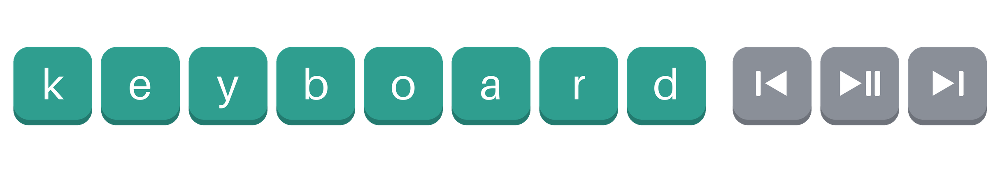
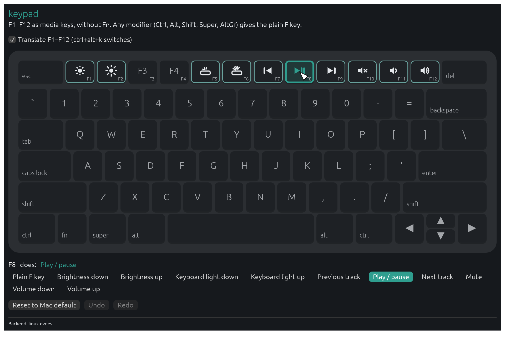

<div align="center">




**F1–F12 as media keys on any keyboard, without holding Fn: brightness, keyboard light, volume, play/pause, previous/next.**

[](#license)
[](Cargo.toml)
[](https://github.com/emilk/egui)
[](#linux)
[](#windows)

[Quick start](#quick-start) · [How it works](#how-it-works) · [Settings](#settings) · [Linux](#linux) · [Windows](#windows) · [Issues](../../issues)

</div>

A small personal tool: laptop and external keyboards send F1–F12 unless you hold Fn, while a Mac
keyboard does the opposite. This app, **keyboard**, makes every keyboard behave like the Mac one.

<p align="center"></p>

## Quick start

Download `keyboard.exe` (Windows, `.zip`) or `keyboard` (Linux, `.tar.gz`) from
[Releases](https://github.com/nicolaepostica/keyboard/releases), or build from source.

### From source

1. Install Rust with [rustup](https://rustup.rs) (stable, 1.95 or newer).
2. `cargo run --release -p keyboard` — the binary lands in `target/release/keyboard` (`keyboard.exe` on Windows).
3. On Linux, give your user access to keyboards once (see [Linux](#linux)).

Command line:

```
keyboard [--control PORT] [--headless] [--minimized] [--no-tray]
```

| Flag | Effect |
|---|---|
| `--minimized` | start in the tray without opening the window (used by "Start at login") |
| `--no-tray` | no tray icon; closing the window quits |
| `--headless` | no window and no tray, just the key translation |
| `--control PORT` | JSON-lines control channel on `127.0.0.1:PORT` (for testing and scripting) |

---

## How it works

| | |
|---|---|
| **Translation** | F1–F12 pressed alone become media keys; your desktop (KDE, GNOME, Windows) then shows its usual volume/brightness pop-up. |
| **Plain F keys** | F + any modifier (Ctrl, Alt, Shift, Super, AltGr) stays a plain F key, so Alt+F4 and Ctrl+F5 keep working. |
| **Fn Lock** | `Ctrl+Alt+K` (configurable) or the tray menu switches translation off and on. |
| **Any keyboard** | the built-in keyboard and every external one, including keyboards plugged in later. |
| **Safe** | if the app stops or crashes, your keyboard goes straight back to normal. |

Default mapping, as on a Mac:

| Key | Action | Key | Action |
|---|---|---|---|
| F1 | brightness down | F7 | previous track |
| F2 | brightness up | F8 | play / pause |
| F3, F4 | plain F keys | F9 | next track |
| F5 | keyboard light down ¹ | F10 | mute |
| F6 | keyboard light up ¹ | F11 | volume down |
| | | F12 | volume up |

¹ Linux only. On Windows the keyboard backlight is controlled by the laptop firmware, so F5/F6
stay plain keys there.

Keys whose firmware already sends media codes (for example with the laptop's own Fn Lock on) pass
through untouched.

## Settings

The window (tray menu → **Settings…**) shows a virtual laptop keyboard: each of F1–F12 carries
the icon of its action. Click a function key, then pick its action below the keyboard. You can
also switch translation on or off, undo/redo changes and reset to the Mac default. Actions your platform cannot perform are
greyed out. Problems, such as missing permissions on Linux, are shown at the top with the exact
commands that fix them.

Settings are saved at once to `config.toml`:

| Platform | Path |
|---|---|
| Linux | `~/.config/keyboard/config.toml` |
| Windows | `%APPDATA%\keyboard\config.toml` |

```toml
enabled = true
toggle = "ctrl+alt+k"
brightness_step = 10   # Windows only, percent per press

[mapping]
f1 = "brightness_down"
f3 = "none"            # plain F3
f8 = "play_pause"
```

Actions: `brightness_down`, `brightness_up`, `kbd_illum_down`, `kbd_illum_up`, `prev_track`,
`play_pause`, `next_track`, `mute`, `volume_down`, `volume_up`, `none`. A broken file is ignored
(the defaults are used and the error is shown in the window); it is only overwritten when you
change a setting.

Shortcut (from the command registry):

| Shortcut | Command |
|---|---|
| `Ctrl+Alt+K` | `mode.toggle`: translation on/off, works everywhere |

---

## Linux

The app reads keyboards through **evdev** and writes through one virtual **uinput** keyboard, below
X11 and Wayland, so it works the same on KDE Plasma and GNOME, on either session type.

It needs access to `/dev/input` and `/dev/uinput`, once:

```sh
sudo usermod -aG input $USER
echo 'KERNEL=="uinput", GROUP="input", MODE="0660", OPTIONS+="static_node=uinput"' | sudo tee /etc/udev/rules.d/99-keyboard-uinput.rules
sudo udevadm control --reload && sudo udevadm trigger
```

Then log out and back in. Members of the `input` group can read every keyboard, which is fine on a
personal laptop.

- **Tray:** KDE shows the icon natively. GNOME needs the *AppIndicator and KStatusNotifierItem
  Support* extension.
- **Start at login** writes `~/.config/autostart/keyboard.desktop`.
- Building needs no GTK or other system libraries for the tray (it uses the StatusNotifierItem
  D-Bus protocol).

**Note: tested against a real Linux kernel (uinput, in a container), not yet on a real KDE or GNOME
desktop.**

## Windows

The app installs a low-level keyboard hook, sends the media keys with `SendInput` and sets the
panel brightness through WMI (`WmiMonitorBrightnessMethods`), since Windows has no brightness key.
External monitors do not support WMI brightness; their brightness keys report an error in the
window. **Start at login** adds `keyboard` under
`HKCU\Software\Microsoft\Windows\CurrentVersion\Run`.

**Note: tested on a real Windows 10 machine with the release build from CI: F8–F12 become media
keys (play/pause, next track, mute, volume). F7 (previous track) and brightness (F1/F2) are not
yet tested there.**

---

## Code structure

| Path | Holds |
|---|---|
| `crates/keyboard-core` | config model (`config.toml`), the pure `Decider` (pass / swallow / emit / toggle) and the backend trait; also builds for wasm |
| `crates/keyboard-linux` | evdev grab, uinput virtual keyboard, hotplug, permission checks |
| `crates/keyboard-windows` | `WH_KEYBOARD_LL` hook, `SendInput`, WMI brightness |
| `crates/keyboard-engine` | session, command registry, undo/redo, panic guard, config file |
| `crates/keyboard-ui` | settings window (egui), tray icon, theme |
| `crates/keyboard` | the binary: arguments, control channel, start at login |
| `xtask` | `cargo xtask ci`: fmt, clippy, tests, layer check, asset check, wasm and cross-platform builds |
| `assets/theme.toml` | the colours used by the app, the icon and the banner |
| `assets/icon.py` | draws `assets/icon.png`, `assets/keyboard.ico`, `docs/assets/keyboard-mark.png` |
| `assets/banner.py` | draws `docs/assets/keyboard-banner.png` |
| `assets/screenshots.sh` | renders `docs/assets/settings.png` |

## Tests

```sh
cargo xtask ci                                      # everything below plus lints and builds
cargo test --workspace                              # unit, property and UI tests
python3 -m unittest discover -s assets -p 'test_*.py'   # asset generators
cargo test -p keyboard-linux -- --ignored             # real-kernel test: needs /dev/uinput (root)
```

The real-kernel test creates a fake keyboard with uinput and checks that F8 becomes play/pause,
letters and Ctrl+F5 pass through, an unplugged keyboard is released and a newly plugged one is
taken over.

## Releasing

Set `version` in `Cargo.toml`, then push a matching tag:

```sh
git tag v0.1.0
git push origin v0.1.0
```

The `Release` workflow tests and builds Windows and Linux packages, then publishes them with a
`SHA256SUMS.txt` as a GitHub release. A tag that does not match the version fails the workflow.

## License

Licensed under either of [Apache License, Version 2.0](LICENSE-APACHE) or
[MIT license](LICENSE-MIT) at your option.

Unless you explicitly state otherwise, any contribution intentionally submitted for inclusion
in this work by you, as defined in the Apache-2.0 license, shall be dual licensed as above,
without any additional terms or conditions.
